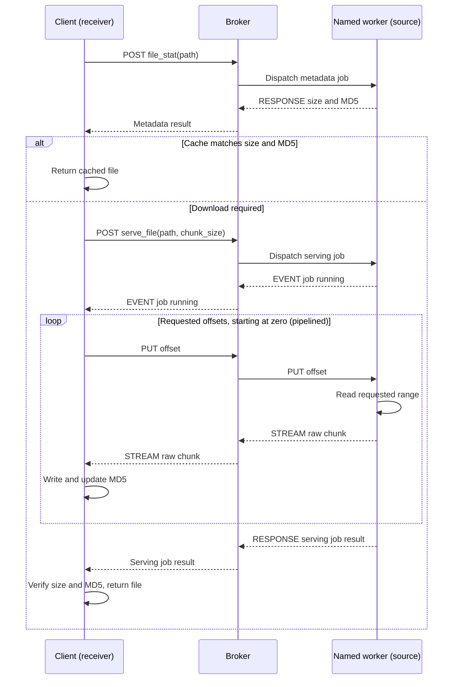
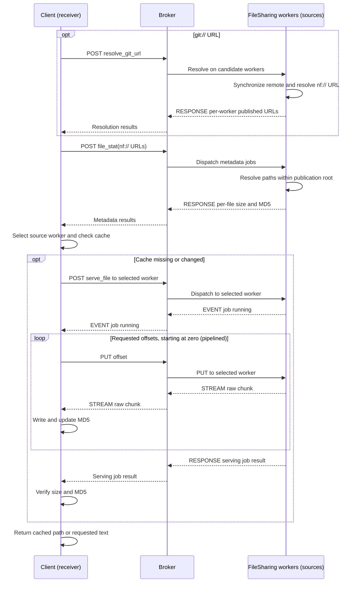
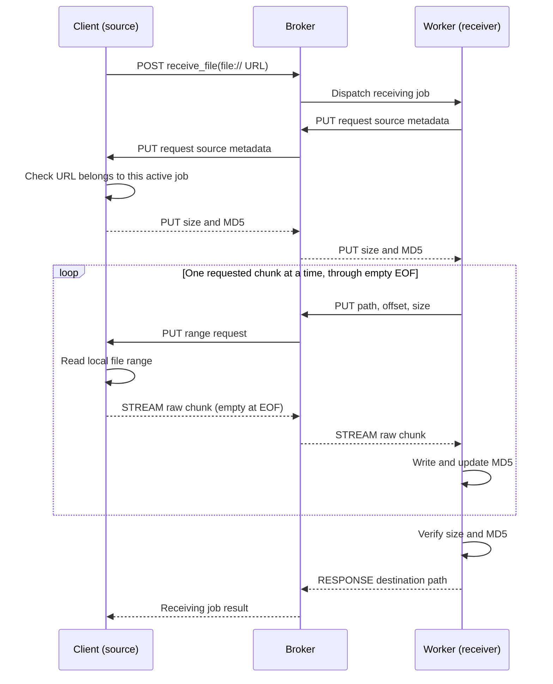
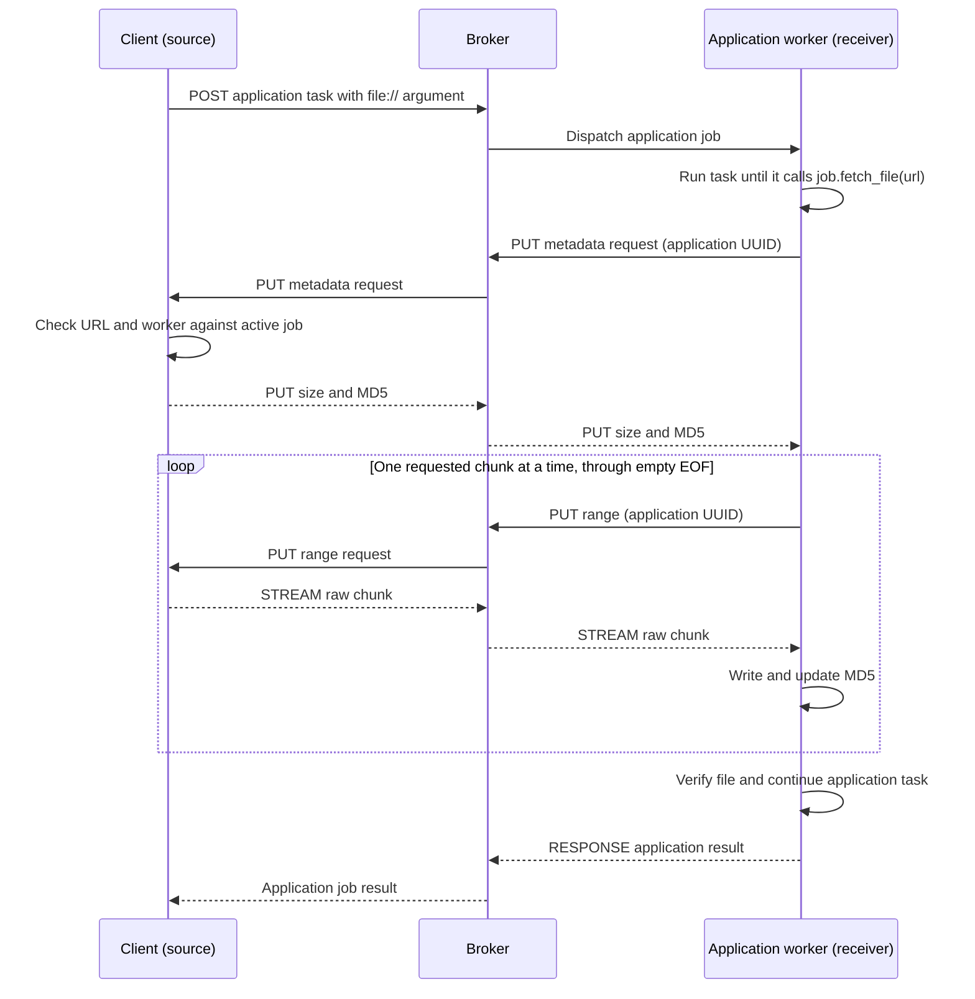
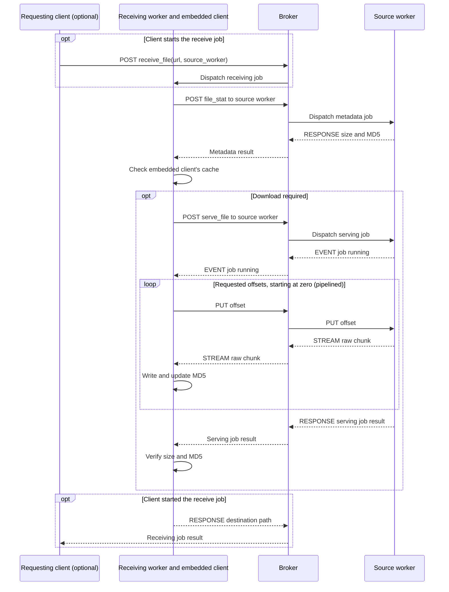
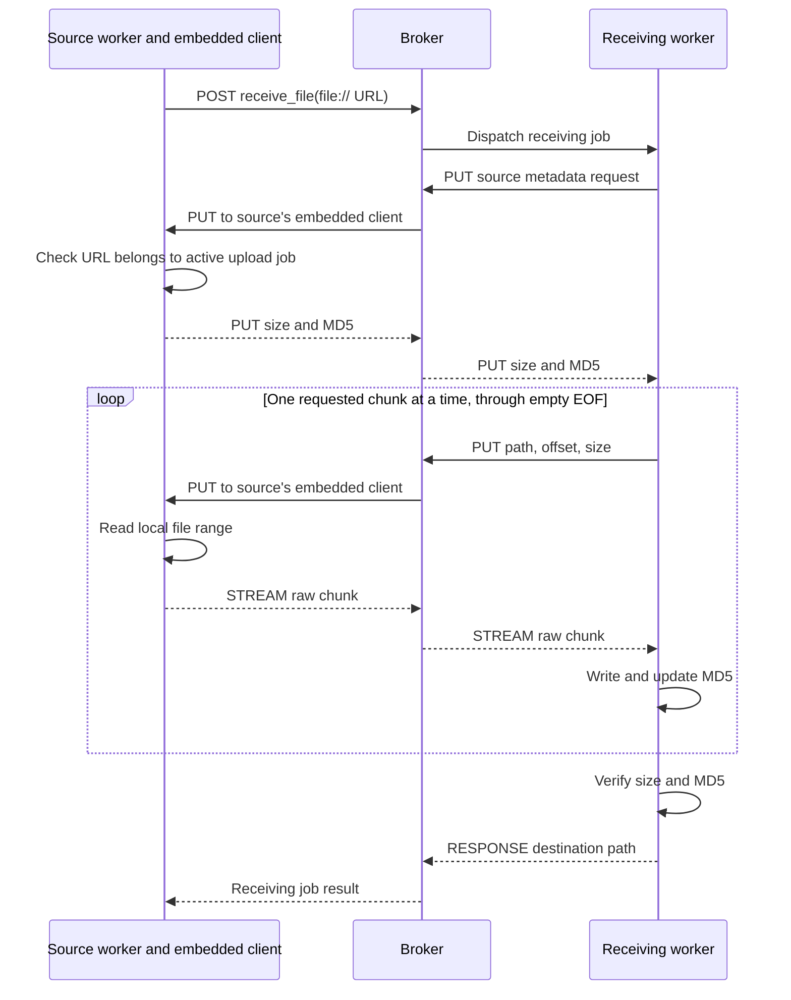

# Core file transfers

Clients and workers transfer files through the broker using the core `file_stat`,
`serve_file`, and `receive_file` tasks. FileSharing supplies the published `nf://`
namespace and Git synchronization.

## Download files

```python
from norfab.core.nfapi import NorFab

with NorFab(inventory="./inventory.yaml") as nf:
    client = nf.make_client()
    published = client.fetch_file("nf://templates/router.j2", read=True)
    remote = client.fetch_file(
        "file:///var/tmp/output.txt",
        worker="nornir-worker-1",
        destination="downloads/output.txt",
    )
```

`client.fetch_file` returns `status`, `content`, and `error`. Successful results
have status `"200"`; content is a local path, or UTF-8 text with `read=True`.
A URL list returns results in input order, including duplicate positions;
an empty list returns `[]`. Local filesystem and decoding errors raise and stop
the batch. Native metadata and transfer timeouts raise `TimeoutError`.

| Source | Worker selection and path resolution |
| --- | --- |
| `nf://templates/router.j2` | Discover FileSharing workers, or select one with `worker`; resolve within its publication directory |
| `git://assets/templates/router.j2` | Synchronize the configured remote, then fetch its published path from the same FileSharing worker |
| `file://outputs/result.txt` | Requires `worker`; relative to that worker's working directory |
| `file:///var/tmp/result.txt` | Requires `worker`; absolute on that worker (`file:///C:/tmp/result.txt` on Windows) |
| Plain filesystem path | Requires `worker`; resolved on that worker |

Without an explicit worker, published files rotate across workers with successful
metadata within each call. Downloads check source size and MD5, reuse matching
cached files, and verify received size and MD5. Published cache paths retain the
published relative path; native cache paths are isolated by worker and source.
`destination` is supported for a single native path with a named worker. Matching
output files are reused; other output files are overwritten.

Download published files from the CLI:

```text
nf#file copy url nf://templates/router.j2
nf#file copy url git://assets/README.md read
```

## Generic client and worker transfers

Upload a local file by asking the destination worker to pull it:

```python
result = client.upload_file("file://inputs/config.txt", "nornir-worker-1")
remote_path = result["nornir-worker-1"]["result"]
```

`upload_file` returns ordinary job results keyed by worker, including `failed`
and `errors`. It accepts `destination`, `chunk_size`, and a job `timeout`.
Without a destination, uploads create a unique file beneath the receiving
worker's client `fetchedfiles` directory. Existing destinations are overwritten.

A worker uses its embedded client to fetch from or upload to another worker:

```python
result = self.client.fetch_file("file://output.txt", worker="worker-a")
self.client.upload_file("file://input.txt", "worker-b")
```

Alternatively, submit `receive_file` to the destination with `url` and
`source_worker`. It returns the local destination path in its job result.

### Files supplied with application jobs

Pass a local `file://` URL unchanged in the job arguments. A task can pull it
when needed using its application job UUID:

```python
def my_task(self, job, config):
    local_path = job.fetch_file(config)
    # Use local_path in the task.
```

Here `file://` paths belong to the submitting client, not the receiving worker.
The URL must be present in the active job's arguments. There is no pre-staging.
Fetch inputs sequentially within each job; use separate jobs for concurrency.
`job.fetch_file("nf://...")` and Git URLs delegate to the worker fetch helper.

`self.fetch_file(url, read=False, raise_on_fail=True)` fetches published nf:// or
Git files through the worker's embedded client. It returns a path or text, or a
list for list input; without `raise_on_fail`, failed entries are `None`.

## Browse worker files

All workers provide `list_files` and `walk` through the native job API:

```python
entries = client.run_job(
    "all", "list_files", workers=["worker-a"],
    kwargs={"url": "file://outputs"},
)
files = client.run_job(
    "all", "walk", workers=["worker-a"],
    kwargs={"url": "file://outputs"},
)
```

`list_files` returns immediate entry names, including hidden entries. `walk`
returns absolute native file paths, usable with `fetch_file(..., worker=...)`.
For nf:// input on FileSharing, it returns published nf:// URLs instead.
Walk omits filenames starting with a dot and roots containing two or more
`__` markers; it does not follow directory symlinks. Inaccessible children are
skipped by os.walk. Invalid or missing roots produce failed results.

`safe_path()` resolves paths for browsing, metadata, serving, and Git mounts.
It confines nf:// paths to the FileSharing publication root; native paths are
not sandboxed. Browsing tasks are not exposed through REST or MCP. The existing
FileSharing CLI listing and completion commands use these inherited core tasks.

## File metadata

`client.file_stat(path)` reads a local file and returns `md5hash`, `size_bytes`,
and `exists` without submitting a job. It accepts a plain path or file:// URL;
missing or unreadable files raise `OSError`. `client.safe_path(url)` resolves
these local paths without sandboxing them. Use `fetch_file` for nf:// and Git URLs.

To inspect a remote worker file, submit the worker task:

```python
metadata = client.run_job(
    "all", "file_stat", workers=["nornir-worker-1"],
    kwargs={"url": "file://output.txt"},
)
```

`file_stat` accepts a string or list. A string returns `md5hash`, `size_bytes`,
and `exists` in the worker result. A list returns per-URL results with independent
failures; entry errors are also collected in the outer result. Only FileSharing
workers accept `nf://`, using their publication-root checks.

Inspect published metadata with
`show filesharing files details url nf://path/file.txt`.

## Transfer implementation

1. The client resolves Git URLs, selects sources through `file_stat`, and checks
   its cache. A named-worker request can inspect published and native paths in
   one metadata job.
2. A cache miss submits one `serve_file(path, chunk_size)` job. On the worker's
   starting event, the client requests offset zero with PUT.
3. The worker reads each requested range and sends raw bytes using STREAM.
   The client writes and hashes bytes, requesting further offsets up to its
   pipeline credit. It checks size/MD5 and the final normal job result.
4. For uploads and application inputs, the worker requests client size/MD5
   metadata through PUT, then pulls one chunk at a time. An empty chunk ends
   the upload; the worker checks size and MD5 before succeeding.

The stream handler writes and hashes chunks and schedules range requests; the
first request consumes pipeline credit. `fetch_file()` waits for the normal job
result, verifies size/MD5, and closes the destination in its cleanup block. A local
write failure stops further range requests and sends an error PUT to the serving
job; the client raises the original write error after collecting the job result.

Both directions use NFP commands and normal job routing. PUT carries
requests and metadata/error controls; file bytes use STREAM. The broker keeps no
file-transfer state. Downloads use the client's job-keyed transfer state;
worker binary input queues are separate from interactive input. Worker file
reads and client upload reads have independent implementations, without a shared
helper module. Client source reads run on its dispatcher, not its socket thread.

### Limits

- Chunk sizes are 1 through 1048576 bytes, defaulting to 256000. Downloads use
  `pipeline=10` by default; uploads request one chunk at a time.
- The default client timeout is 600 seconds per metadata or download job.
  `Job.fetch_file` uses its remaining application-job timeout.
- Sources must remain stable. MD5 detects accidental corruption, not authenticity.
  Transfers have no resume, retries, or snapshot consistency; interruptions may
  leave partial output files.
- Serving occupies a worker job slot. Nested transfers can contend for slots;
  slow client reads can delay dispatch of other jobs.
- Native paths require trusted filesystem access. Core transfer tasks are not
  exposed through REST or MCP. FileSharing publication-root checks apply to nf://.

## Transfer scenarios

Each vertical lifeline represents a client, broker, or worker; time runs downward.
All peer messages pass through the broker. Job acknowledgements, result GETs,
and unrelated events are omitted to keep the transfer exchange visible.
`RESPONSE` below represents the normal job result, not file bytes.

### Client downloads from a named worker

`client.fetch_file(path, worker=...)` checks metadata and the cache before
starting a serving job. The first range request follows the starting event.



### Client downloads a published or Git file

`nf://` uses FileSharing discovery. `git://` first synchronizes the configured
remote and resolves its published URL. Metadata and bytes must come from the
same selected worker; the remaining download flow is the native serving flow.



### Client uploads a local file

`client.upload_file` starts `receive_file`. The receiving worker requests
metadata and chunks using that job's UUID; the client never sends file bytes
through PUT.



### Application job fetches a client file on demand

The file URL travels with the application arguments. `job.fetch_file` performs
the pull only when the task needs it, using the application job's UUID rather
than a separate receive job.



### Worker fetches from another worker

The receiving worker uses its embedded client. An external client can optionally
start this flow with `receive_file(url, source_worker=...)`; the source-serving
job has its own UUID, separate from that outer receive job.



### Worker uploads to another worker

The source worker calls `self.client.upload_file`. Its embedded client serves
the source file; the destination still controls the chunk requests.



The diagrams show successful transfers. Read errors fail the serving job or
return a `file_error` PUT control reply; checksum failures prevent success.

## Python API reference

- [Client methods](api_reference_core_norfab_client.md): `fetch_file`, `upload_file`, `file_stat`, `safe_path`.
- [Worker and Job methods](api_reference_core_norfab_worker.md): `safe_path`, `list_files`, `walk`, `file_stat`, `serve_file`, `receive_file`, and `fetch_file`.
