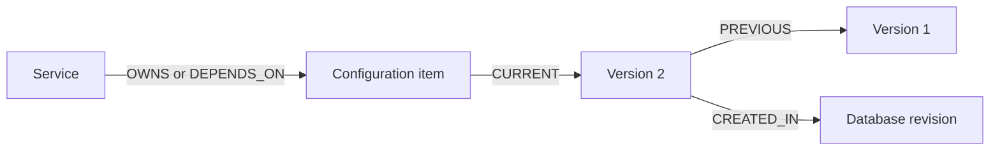

# ADR - Service-Owned Configuration Graph and Reconciliation

## Status

Draft, 2026-11-03. Living design canvas; not implemented. LadybugDB is selected.
Confirmed decisions and unaccepted proposals are separated below.

## Context

Represent device configuration as linked path-item nodes, populated from NETCONF
XML or gNMI/RESTCONF JSON. Represent network services separately and link them to
configuration they own or depend on. Detect drift and generate corrective changes
for whole-device synchronization in either direction.

## Decisions

| Area | Confirmed behavior |
| --- | --- |
| Storage (Q1, Q15) | One LadybugDB database with two logical parts: device configuration and network services. A network service is distinct from a NorFab worker service. |
| Desired state (Q2, Q16) | Database configuration is desired state, whether populated by discovery/import or service changes. No separate persistent observed-state graph. Comparison reads device data without importing it. |
| Reconciliation (Q3-Q6, Q10) | DB → device enforces desired state; device → DB replaces desired state with device configuration. Scope is the whole device configuration. Generate corrective operations; export and byte-for-byte reproduction are unnecessary. |
| Execution (Q9) | Generate a reviewable plan with affected services, operations, and the observations used to calculate it. Applying the plan is a separate explicit action. |
| Services (Q8, Q14) | Parameterized declarations specify paths, values, and relationships to create. Retain definitions, instance parameters, and ownership associations. Syntax and model coverage remain open. |
| References (Q7, Q17) | Multiple services may own or depend on one item. Distinguish ownership from dependency. Links follow stable item identities across imports; retain evidence of disappearance to report affected services. |
| Overrides (Q11, Q18) | Newer updates override earlier values without a conflict error, regardless of service creation order. Concurrent-update ordering remains open. |
| Removal (Q12, Q19) | Remove a service's owned configuration only when no surviving service uses or depends on it. Retained entries keep their current values; removing an overriding service does not restore an earlier owner's value. Device changes follow the plan/application flow. |
| Import conflicts (Q13) | Import succeeds and affected services are marked inconsistent. Preserve their definitions; do not automatically regenerate configuration or rewrite intent. |

For example: A writes MTU `9000`; B writes `1500`. Removing B leaves `1500`
while A still needs the item. A later update can set `9000` again. Service removal
does not sweep unrelated, unowned configuration imported from devices.

## Proposed versioning — Q20, not accepted

Keep service links on stable item identities and append immutable value versions:

- Group one accepted operation into a revision covering configuration, service
  definitions/parameters, containment, ownership, dependencies, and deletions.
  Reuse unchanged versions instead of copying the whole graph.
- Retain deleted-state records and relationship history. Value chains alone
  cannot reconstruct the complete historical graph.
- Propose monotonic committed revisions with UTC timestamps and provenance.
  Reconstruct at one revision; a time query selects the latest committed revision
  at or before that time. Device event timestamps do not automatically determine
  update precedence.
- History contains previous desired states, not a second current observed state.
  Any future explicit rollback would create a new revision; service removal
  would still not restore earlier values automatically.

These are established [graph versioning patterns](https://neo4j.com/docs/getting-started/data-modeling/versioning/).
Ladybug provides [temporal types](https://docs.ladybugdb.com/cypher/data-types/)
and [transactions](https://docs.ladybugdb.com/cypher/transaction/), but a built-in
durable time-travel facility has not been verified. The proposal uses explicit
application-managed history.

## Open decisions

- **Q20 — History scope:** Version configuration, services, relationships, and
  deletions together? Recommendation: yes, using the model above. Schema,
  retention, timestamp semantics, and rollback behavior remain undecided.
- **Q21 — Override status:** Mark A inconsistent when B's newer update contradicts
  A's requirements? Recommendation: yes, without rejecting B's update or
  automatically reapplying A. Only import-conflict status is confirmed so far.

Remaining branches:

- **Model:** Stable identity keys, namespaces/schema revisions, list keys and
  ordering, defaults, types, presence, missing and not-yet-deployed items.
- **Lifecycle:** Ownership granularity, indirect dependencies, parent/child
  deletion, cleanup after the final dependency disappears, and update scope.
- **Reconciliation:** Complete versus partial collection, unreadable configuration,
  stale plans, retries, concurrent writes, failure recovery, and verification.
- **Deployment:** First device/model/protocol scope, definition syntax, operation
  format, worker ownership of database access, package version, scale, and recovery.

## Constraints and trade-offs

Ladybug was selected for embedded graph storage with Python and Cypher.
SQLite node/edge tables, DuckDB/DuckPGQ, and FalkorDBLite were considered but not
selected. Ladybug has not been installed or benchmarked for this workload.

Ladybug permits one read-write Database object or multiple read-only objects;
connections may share the writable object within one process. It permits one
write transaction at a time. One NorFab worker owning database access is a
proposal, not an accepted deployment. See [concurrency](https://docs.ladybugdb.com/concurrency/)
and [transactions](https://docs.ladybugdb.com/cypher/transaction/).

Protocol semantics must inform comparison and corrective operations:

- YANG keys, user ordering, writable versus operational data, and default reporting
  affect identity and meaningful drift. See [YANG](https://www.rfc-editor.org/rfc/rfc7950.html)
  and [NETCONF defaults](https://www.rfc-editor.org/rfc/rfc6243.html).
- NETCONF merge/replacement and delete/remove differ; rollback depends on
  capabilities. See [edit-config](https://www.rfc-editor.org/rfc/rfc6241.html#section-7.2).
- gNMI Set is transactional within one request, with ordinary operations ordered
  delete → replace → update, not across requests or devices. See [gNMI Set](https://github.com/openconfig/reference/blob/master/rpc/gnmi/gnmi-specification.md#34-modifying-state).
- RESTCONF plain PATCH cannot delete child resources; optional YANG Patch supports
  ordered atomic edits. Conditional requests can reject stale writes. See
  [RESTCONF](https://www.rfc-editor.org/rfc/rfc8040.html) and [YANG Patch](https://www.rfc-editor.org/rfc/rfc8072.html).

Validate actual platform capabilities, collection completeness, shared-item
removal, stale plans, and recovery before implementing device writes.
