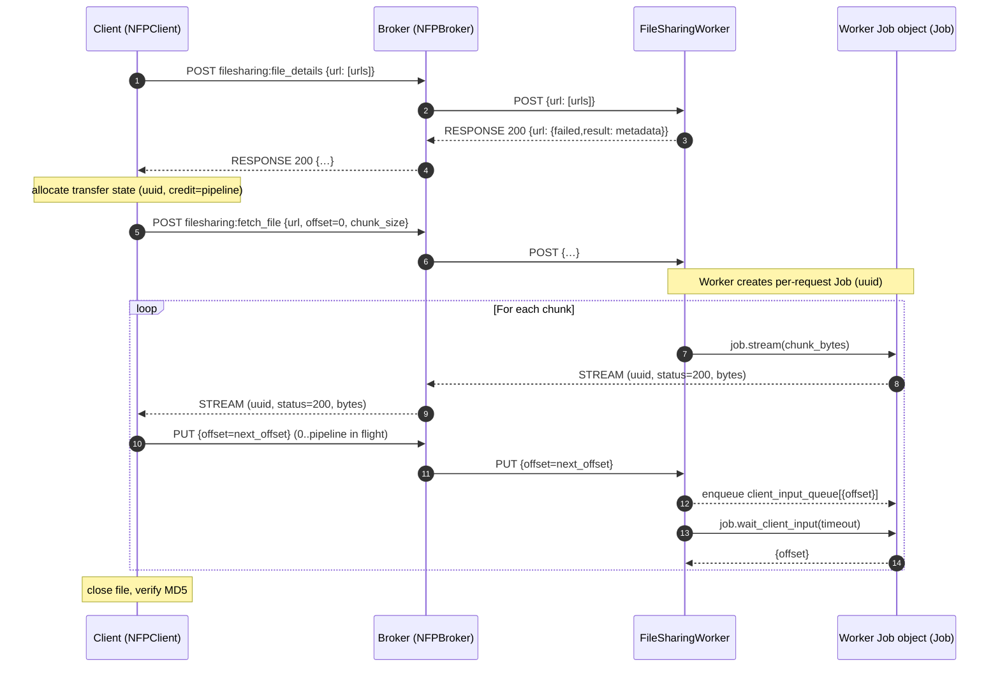

# Client file streaming (`fetch_file`) and NFP `STREAM`/`PUT`

This page documents how the Python client downloads files via the built-in **File Sharing Service** (`service="filesharing"`) using a streaming data path.

The implementation is split across:

- Client: `norfab/core/client.py`
- Broker routing: `norfab/core/broker.py`
- Worker core queues/threads: `norfab/core/worker.py`
- File Sharing worker tasks: `norfab/workers/filesharing_worker/filesharing_worker.py`
- Protocol constants/builders: `norfab/core/NFP.py`

## Purpose

`NFPClient.fetch_file()` accepts an `nf://...` or `git://...` URL string or a list of URLs and downloads files from a `filesharing` worker into the client’s local `fetchedfiles/` folder.

`filesharing` is a built-in NORFAB service. When you start NORFAB via `NorFab` (NFAPI) with broker enabled, NFAPI injects a default File Sharing worker (`filesharing-worker-1`) into the inventory and adds it to the topology so it is started alongside other workers.

Unlike most tasks (which return JSON via `RESPONSE`), file content is delivered as raw bytes over `NFP.STREAM`. The client uses `NFP.PUT` to request subsequent chunks (offset-based), implementing a simple **sliding window** ("pipeline") to avoid uncontrolled buffering.

### Built-in service lifecycle (NFAPI)

This is implemented in `norfab/core/nfapi.py`:

- `NorFab.start()` calls `add_built_in_workers_inventory()` when `run_broker` is enabled and the inventory topology has `broker: true`.
- `add_built_in_workers_inventory()` adds `filesharing-worker-1` with `service: filesharing` and `base_dir: <inventory.base_dir>`.
- The worker name is inserted into `inventory.topology["workers"]` (at the beginning), so it gets started like any other worker.

## High-level flow

1. Normalize a string or URL list internally without deduplicating it.
2. Resolve Git URLs in one request using `workers="all"`. Each worker
   synchronizes each referenced remote once per request.
3. Request file metadata from all workers in one batch, including resolved Git
   paths. Select an available worker per file, rotating through workers within
   this call and skipping missing or failed entries. For Git URLs, use that
   worker's resolved path.
4. Hash cached files and reuse matching copies without creating transfer state.
5. Download changed or absent files sequentially from their selected workers using
   the existing single-file task and STREAM/PUT protocol. Each transfer has a UUID.
6. Check download results and streamed hashes, closing files and clearing transfer
   state after the transfer job returns, including failed replies.

There is no fixed client-side limit of 100 URLs per metadata request.

String input returns the original single-file `{status, content, error}` response.
List input returns a list of those responses in the same order, retaining duplicate
positions. With `read=False`, content is the cached
path; with `read=True`, it is UTF-8 text. Empty lists return `[]` without jobs.
Discovery and worker failures are returned per file. Local file errors propagate
to the caller and stop the batch. Each file uses metadata and content from the
same worker.

`NFPWorker.fetch_file(url)` returns one file's content or path; a URL list returns
a list of contents or paths in input order. Failed entries are `None`.
`raise_on_fail=True` raises after processing the batch and identifies failed URLs.
NFCLI retains its existing single-file calls.

Metadata and Git-resolution tasks also preserve their original single-string
responses. List inputs return per-URL result mappings containing `failed`,
`errors`, and `result`; the client consumes those mappings internally.
The wire-level streaming task still handles one file per job; its inputs and
raw stream framing are unchanged. `timeout` applies to each submitted job.

### Flow diagram



## Threading model (what runs where)

### Client-side threads

The client uses a dedicated ZeroMQ send/receive thread and a dispatcher thread.

- **ZeroMQ send/receive thread**: `zmq_send_recv(client)`
  - The *only* owner of the ZeroMQ socket.
  - Parses incoming multipart frames.
  - For `NFP.STREAM`: calls `handle_stream()` and (importantly) sends `NFP.PUT` requests for further chunks.
  - For `NFP.RESPONSE`/`NFP.EVENT`: updates the client-side SQLite job DB and enqueues messages for synchronous consumers.

- **Dispatcher thread**: `dispatcher(client)`
  - Finds jobs in the local job DB and queues `POST` / `GET` messages for the socket owner thread.
  - `fetch_file()` uses this job pipeline for:
    - `filesharing.file_details` (a standard JSON response)
    - `filesharing.fetch_file` (which primarily streams data)

### Worker-side threads

Each worker runs a small set of queue-driven threads.

- `zmq_send_recv(worker, destroy_event)`: owns the broker socket, sends queued outbound messages and keepalives, and fan-outs received commands into queues
- `_post(...)`: handles `NFP.POST` (creates job record + ACK)
- `_get(...)`: handles `NFP.GET` (status/result polling)
- `_event(...)`: emits `NFP.EVENT`
- `_put(...)`: handles `NFP.PUT` and forwards decoded JSON into `running_jobs[uuid].client_input_queue`

The File Sharing worker task `fetch_file(job, ...)` then consumes those inputs using:

- `job.wait_client_input(timeout=chunk_timeout)`

This is how the worker learns which offsets to send next.

## Messaging formats

This section describes the multipart frame layout as it appears to each endpoint.

### Client ↔ Broker (DEALER ↔ ROUTER)

The client is a `zmq.DEALER`. The broker is a `zmq.ROUTER`.

From the client’s perspective (what `zmq_send_recv(client)` expects):

- Incoming from broker:

```text
[ empty, header, command, service, uuid, status, payload ]
```

Where:
- `header` is `NFP.BROKER`
- `command` is typically `NFP.RESPONSE`, `NFP.EVENT`, or `NFP.STREAM`
- `payload` is:
  - JSON bytes for `RESPONSE`/`EVENT`
  - raw file bytes for `STREAM`

From the broker’s perspective, messages include an initial identity frame that the client does not see.

### Worker ↔ Broker (DEALER ↔ ROUTER)

Workers are also `zmq.DEALER`. The broker is `zmq.ROUTER`.

Broker → worker (built by `NFP.MessageBuilder.broker_to_worker_put`):

```text
[ worker_id, empty, NFP.BROKER, NFP.PUT, sender_id, empty, uuid, request_json ]
```

Worker-side `zmq_send_recv(worker, ...)` strips the initial `empty`, reads `header` + `command`, then pushes the remaining frames into `put_queue`.

In `_put(...)`, the queued `work` list is treated as:

- `work[2]` = `uuid`
- `work[3]` = JSON payload

### `STREAM` payload

A stream chunk originates from the worker job via `Job.stream(data)`:

```python
msg = [
  client_address, b"", juuid, b"200", data_bytes
]
worker.send_to_broker(NFP.STREAM, msg)
```

The broker forwards `STREAM` to the client without wrapping the chunk into JSON.

## How `PUT` is used (client → worker)

In file download, `PUT` does not upload file content.

Instead, `PUT` is used as a *client-to-worker control channel* tied to the same job UUID.

- Client sends `PUT` with JSON: `{ "offset": <int> }`
- Broker routes it to the same worker that is executing the job
- Worker `_put` thread places that dict into the running job’s `client_input_queue`
- FileSharingWorker’s `fetch_file` task reads it with `job.wait_client_input()` and updates `offset`

This design provides a simple backpressure mechanism: the worker only sends the next chunk after the client requests it.

## Sliding window / pipeline (backpressure)

Client-side `pipeline` is implemented as a credit counter in `client.file_transfers[uuid]`:

- Start: `credit = pipeline`
- Each received chunk: `credit += 1`
- Each `PUT` request sent: `credit -= 1`

After writing a chunk, the client sends up to `credit` additional `PUT` requests (while there are offsets remaining), which keeps up to ~`pipeline` requests "in flight".

This keeps throughput reasonable without letting either side buffer an unbounded amount of data.

## Completion and integrity checking

Completion is detected purely by byte count:

- Client tracks `total_bytes_received` and compares to `size_bytes`.
- When equal:
  - Close the destination file
  - Verify MD5 hash against `file_details.md5hash`

If MD5 mismatches, the client marks the job as failed and logs an error.

## Operational notes / gotchas

- **Timeouts**
  - Worker `filesharing.fetch_file` defaults `chunk_timeout=5` seconds.
  - If the client stops sending `PUT` requests, the worker raises `RuntimeError`.
  - Client `fetch_file(timeout=...)` sets the timeout for each submitted job, not a shared whole-batch deadline.

- **Local storage path**
  - Downloads go to `${base_dir}/fetchedfiles/<nf-path>`.

- **Binary vs text**
  - `fetch_file(read=True)` opens the downloaded file as UTF-8 text (`open(..., "r", encoding="utf-8")`).
  - For binary files, prefer `read=False` and open the returned path in binary mode.

- **Worker selection**
  - Discovery queries all workers. Each call rotates file selections across workers
    with successful metadata; transfers use the selected worker.

## Debugging tips

- Enable debug logging for `norfab.core.client`, `norfab.core.broker`, and `norfab.core.worker`.
- Look for:
  - Client: `received stream for unknown file transfer` (mismatched/expired UUID)
  - Worker: `chunk timeout reached before received next chunk request`
  - Client: `MD5 hash mismatch`
