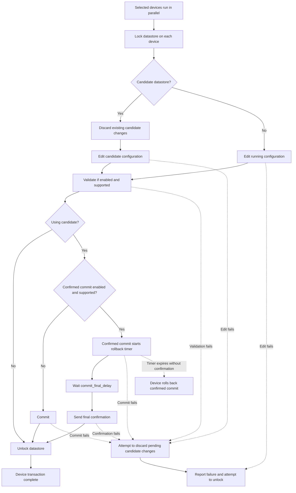

# NETCONF Transaction

Use `netconf_transaction` to apply configuration to selected devices with
locking, validation, commit, and failure recovery according to each device's
NETCONF capabilities. Confirmed commit provides automatic rollback if the final
confirmation does not arrive before the device's timer expires.

## Use Cases

- **Parallel rollouts:** update routing policies across several routers while
  datastore locks prevent overlapping configuration edits on each device.
- **Recover from failed changes:** stage configuration in candidate, validate it
  before activation, and discard pending changes if editing, validation, or commit fails.
- **Commit-confirmed changes beyond the CLI:** use NETCONF candidate and
  confirmed-commit capabilities on devices whose ordinary CLI workflow does not
  use commits, such as Cisco IOS XE and NX-OS devices.

## How It Works

The workflow uses the candidate and confirmed-commit capabilities defined in
[RFC 6241](https://www.rfc-editor.org/rfc/rfc6241.html#section-8.4).
Support depends on the platform, software release, and enabled NETCONF features;
see the [IOS XE NETCONF guide](https://www.cisco.com/c/en/us/td/docs/ios-xml/ios/prog/configuration/1715/b_1715_programmability_cg/netconf_protocol.html)
and [NX-OS NETCONF guide](https://www.cisco.com/c/en/us/td/docs/dcn/nx-os/nexus9000/105x/programmability/cisco-nexus-9000-series-nx-os-programmability-guide-105x/m-netconf-agent.html).

For each selected device:

1. Lock the target datastore: candidate when available, otherwise running, unless explicitly selected.
2. Discard existing uncommitted changes when using candidate.
3. Apply the configuration to the target datastore.
4. Validate the configuration when enabled and supported.
5. Commit candidate changes. When confirmed commit is enabled and supported,
   start the rollback timer, wait `commit_final_delay`, and send the final confirmation.
6. Unlock the datastore and return the transaction results.

If editing, validation, or commit fails, attempt to discard pending candidate
changes and release the lock. If a confirmed commit is not confirmed before its
timer expires, the device rolls back the change.



Failure recovery applies to each device independently. Discarding candidate
changes does not undo running edits or changes already committed.

### How To Enable candidate datastore on Cisco IOS XE

On IOS XE devices, enable the candidate datastore in global
configuration mode:

```text
Device(config)# netconf-yang feature candidate-datastore
```

This also enables NETCONF confirmed commit support. Changing this setting
restarts NETCONF/RESTCONF services and disconnects active sessions; see the
[IOS XE candidate configuration guide](https://www.cisco.com/c/en/us/td/docs/ios-xml/ios/prog/configuration/1715/b_1715_programmability_cg/netconf_protocol.html).

## Output

Results contain an ordered list of step dictionaries under each host's
`transaction` key. Steps can include `discard_changes`, `edit_config`, `validate`,
`commit_confirmed`, `commit`, and `error`, depending on the backend, capabilities,
and outcome. Lock and unlock replies are not included in the step list.
Failed RPCs and connection errors mark host results as failed.
`add_details=True` includes task metadata; `to_dict=False` returns serialized records.

## Examples

=== "CLI"

    ```text
    nf# nornir netconf transaction config nf://netconf/interface.xml plugin scrapli FL ceos-leaf-1
    ```

=== "Python"

    ```python
    from norfab.core.nfapi import NorFab

    with NorFab(inventory="inventory.yaml") as nf:
        client = nf.make_client()
        result = client.run_job(
            "nornir", "netconf_transaction",
            kwargs={
                "config": "nf://netconf/interface.xml",
                "job_data": {"description": "Lab uplink"},
                "plugin": "ncclient",
                "FL": ["ceos-leaf-1"],
            },
        )
        print(result)
    ```

## Notes

- Set up device access using the [NETCONF connection inventory](services_nornir_service_inventory.md#netconf-connection-inventory).
- Supply XML inside a `<config>` wrapper, either inline or in a template file.
  Use `host` and `job_data` in templates for device-specific values.
- By default, changes use candidate when available, otherwise running.
  Existing uncommitted candidate changes are discarded before applying yours.
- Confirmed commits are automatically confirmed after `commit_final_delay`
  (default: 1 second), without checking connectivity or service health.

## Task Command Shell Reference

```bash
nf#man tree nornir.netconf.transaction

R - required field, M - supports multiline input, D - dynamic key

root
└── nornir:    Nornir service
    └── netconf:    Manage devices using NETCONF
        └── transaction:    Apply configuration using a NETCONF transaction
            ├── timeout:    Job timeout
            ├── workers:    Filter workers to target, default 'all'
            ├── verbose-result:    Control output details, default 'False'
            ├── nowait:    Do not wait for job to complete, default 'False'
            ├── FO:    Filter hosts using a Nornir-Salt Filter Object
            ├── FB:    Filter hosts by name using glob patterns
            ├── FH:    Filter hosts by hostname
            ├── FC:    Filter hosts by name containment pattern
            ├── FR:    Filter hosts by name using regular expressions
            ├── FG:    Filter hosts by group
            ├── FP:    Filter hosts by hostname using IP prefix
            ├── FL:    Filter hosts by names list
            ├── FM:    Filter hosts by platform
            ├── FX:    Exclude hosts by name
            ├── FN:    Negate the host filter match
            ├── on-failed:    Run task on hosts currently marked as failed by Nornir, default 'False'
            ├── to-dict:    Return task results as a dictionary keyed by host, default 'True'
            ├── add-details:    Add Nornir task execution details to results, default 'False'
            ├── progress:    Emit progress events during task execution, default 'True'
            ├── num-workers:    RetryRunner number of threads for task execution
            ├── num-connectors:    RetryRunner number of threads for device connections
            ├── connect-retry:    RetryRunner number of connection attempts
            ├── task-retry:    RetryRunner number of attempts to run each task
            ├── reconnect-on-fail:    RetryRunner reconnects to a host after task failure
            ├── connect-check:    RetryRunner tests TCP connectivity before opening connection
            ├── connect-timeout:    RetryRunner TCP connection check timeout in seconds
            ├── creds-retry:    RetryRunner connection credentials and parameters to retry
            ├── tf:    File group name to save task results on the worker
            ├── tf-skip-failed:    Skip failed task results when saving to file
            ├── diff:    File group name to diff task results against
            ├── diff-last:    Previous saved file version to diff against
            ├── plugin:    NETCONF backend, default 'NetconfPlugin.ncclient'
            ├── config (R):    XML config wrapper or NorFab template URL
            ├── target:    Datastore to edit; omit for backend automatic selection
            ├── job-data:    Template data or YAML file URL
            ├── validate:    Validate when supported by the device, default 'True'
            ├── confirmed:    Use confirmed commit when supported, default 'True'
            ├── confirm-delay:    Confirmed commit timeout in seconds, default '60'
            ├── commit-final-delay:    Delay before final commit in seconds, default '1'
            ├── edit-rpc:    ncclient configuration edit RPC; unused by Scrapli, default 'edit_config'
            ├── edit-arg:    ncclient edit RPC arguments; unused by Scrapli, default '{}'
            └── commit-arg:    ncclient first commit arguments; unused by Scrapli, default '{}'
nf#
```

The command inherits common host filters, job options, and serialization options.
Transaction arguments use hyphenated names such as `job-data`, `confirm-delay`,
`commit-final-delay`, `edit-rpc`, `edit-arg`, and `commit-arg`.

## Python API Reference

::: norfab.workers.nornir_worker.netconf_task.NetconfTask.netconf_transaction
